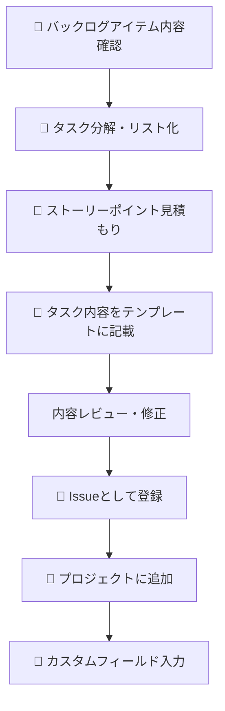

# バックログアイテムからタスク作成・登録手順

## 前提条件

- タスク分解・Issue作成・プロジェクト管理には **GitHub Copilot** を活用すること。
- IssueやProjectの操作は、**gh CLIのGitHub Agentモード**（Copilot ChatやCopilot CLIからの自動化操作）を利用すること。
- GitHubのIssueは「登録しただけ」ではプロジェクト（カンバンボード）に自動で追加されない。**必ずProject（Kanban）に手動または自動で追加する操作が必要**。
- 本手順はGitHub Projects（Kanban型プロジェクト）を前提としている。

## 概要

バックログアイテム（親Issue）からタスク（子Issue）を分解・見積もり・登録し、GitHub Projectsで一元管理するまでの流れをまとめます。

---

## 手順フロー（全体像）

凡例：

- 🤖：GitHub Copilotが主に関与する工程



---

## 詳細手順

1. **バックログアイテム内容を確認**
   - ユーザーストーリー・受け入れ基準・補足を把握

2. **タスクに分解しリスト化**
   - 例：

        | タスクNo | タスク内容                           | Priority | Size | Estimate |
        |----------|--------------------------------------|----------|------|----------|
        | #1       | 朝会の司会担当者を決定する           | P0       | S    | 1        |
        | #2       | 朝会の司会担当スケジュールを作成する | P1       | M    | 2        |
        | #3       | スクラムイベントで司会割り当てを周知 | P1       | S    | 1        |
        | #4       | 朝会の司会進行マニュアルを作成・共有 | P2       | M    | 3        |
        | #5       | 朝会の実施状況を記録・振り返る       | P2       | S    | 1        |

3. **テンプレートに従いタスクIssueを記載**

   - `.github/ISSUE_TEMPLATE/task.md` を利用
   - 概要・詳細・完了の定義・関連情報を記載

4. **内容をレビューし、必要に応じて修正**

5. **gh CLI等でIssueとして登録**
   - 例：

     ```sh
     gh issue create --title "[#6] 朝会の司会担当者を決定する" --body-file "tasks/task-6-1.md" --label "task" --milestone "Sprint 1"
     ```

6. **プロジェクトにIssueを追加**
   - 例：

     ```sh
     gh project item-add 2 --owner <オーナー名> --url <IssueのURL>
     ```

7. **カスタムフィールド（Priority, Size, Estimate等）を入力**
   - 例：

     ```sh
     gh project item-edit --id <item-id> --field-id <field-id> --project-id <project-id> --single-select-option-id <option-id>
     ```

---

## ポイント

- タスク分解・見積もりはチームで合意して進める
- テンプレート・運用ルールは `copilot-instructions.md` も参照
- 進捗・見積もり・優先度はProjectsで一元管理

---

## 参考

### backlog-item.md テンプレート

```markdown
---
name: backlog-item
about: バックログアイテム（ユーザーストーリー）用テンプレート
---

## バックログアイテム

### ユーザーストーリー

- [ ] <役割>として、<目的>がしたい。なぜなら<理由>だからだ。

### 受け入れ基準

- [ ] <具体的な受け入れ条件1>
- [ ] <具体的な受け入れ条件2>

### タスク分解

- [ ]  <サブタスク1>
- [ ]  <サブタスク2>

### 補足・備考

- <関連情報や注意点>
```

### task.md テンプレート

```markdown
---
name: task
about: タスク（子Issue）用テンプレート
---

## タスク

### 概要

- このタスクで実施する作業内容を簡潔に記載してください。

### 詳細

- 必要に応じて、具体的な手順や注意点、関連Issueなどを記載してください。

### 完了の定義（Definition of Done）

- [ ] 完了条件や受け入れ基準を明確に記載してください。

### 関連情報

- 親Issue: #<親Issue番号>
- マイルストーン: Sprint 1 など
```


