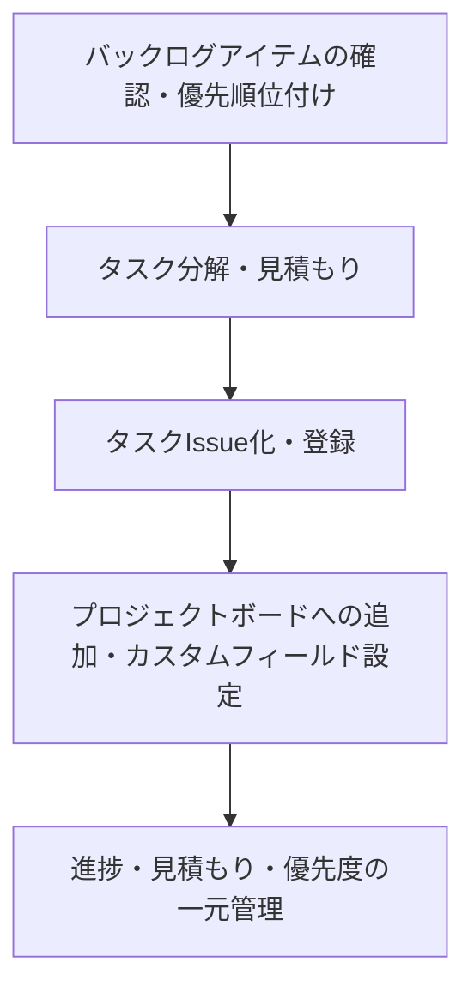

## GitHub Copilotを活用したスプリントプランニングの進め方

### 概要

GitHub Copilotとgh CLIを活用することで、スプリントプランニングの各工程（バックログアイテムの分解・見積もり・タスク化・Issue/Project登録・進捗管理）を効率化できます。以下に、スプリントプランニングに関わる主要な内容・手順をまとめます。

### スプリントプランニングの主な流れ



1. **バックログアイテムの確認・優先順位付け**
   - Product Ownerやチームでバックログを確認し、スプリント対象を決定
   - Copilotでユーザーストーリーや受け入れ基準の要約・整理も可能

2. **タスク分解・見積もり**
   - Copilotでバックログアイテムをタスクに分解し、各タスクのPriority/Size/Estimateを自動生成
   - チームで見積もりをレビューし、合意形成

3. **タスクIssue化・登録**
   - `.github/ISSUE_TEMPLATE/task.md`テンプレートを活用し、CopilotでタスクIssue本文を自動生成
   - gh CLIでIssue登録、マイルストーン（例: Sprint 1）やラベル付与

4. **プロジェクトボードへの追加・カスタムフィールド設定**
   - gh CLIでIssueをKanban型Projectに追加
   - Priority/Size/Estimate等のカスタムフィールドを設定

5. **進捗・見積もり・優先度の一元管理**
   - Projectsでタスクの進捗・見積もり・優先度を可視化
   - Copilotで進捗レポートやふりかえり用サマリも自動生成可能

### Copilot活用のポイント

- バックログアイテムの要約や受け入れ基準の整理を自動化し、議論の土台を素早く作る
- タスク分解や見積もり（Priority/Size/Estimate）のたたき台を自動生成し、チームの合意形成を加速
- タスクIssue本文やテンプレート記載を自動化し、記述ミスや抜け漏れを防止
- gh CLIコマンド例や運用ガイドを自動生成し、手順の標準化・属人化排除に役立てる
- プロジェクトボードやカスタムフィールドの設定例も自動提案し、管理の一元化を支援
- スプリント進捗レポートやふりかえり用サマリを自動生成し、振り返りの効率化・可視化を促進
- ソースコード修正が必要なタスクでは、修正対象箇所の特定やサンプルコード提案を活用し、実装・レビューを効率化
- Copilotの提案は必ずチームでレビューし、最終判断は人が行うことで品質と納得感を担保

### 参考コマンド例

```sh
# タスクIssueの作成
gh issue create --title "[#5] 氏名クリック時のイベントハンドラを実装する" --body-file "tasks/task-5-1.md" --label "task" --milestone "Sprint 1"

# プロジェクトへの追加
gh project item-add 2 --owner Abd-tG84 --url https://github.com/Abd-tG84/Copilot-test/issues/20

# カスタムフィールドの編集
gh project item-edit --id <item-id> --field-id <field-id> --project-id <project-id> --single-select-option-id <option-id>
```

### スプリントプランニングでCopilotが支援できること

- バックログアイテムの要約・分解・見積もり
- タスクIssue本文の自動生成
- コマンド例や運用ガイドの自動生成
- 進捗レポートやふりかえり用サマリの作成

---
